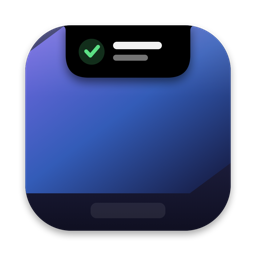
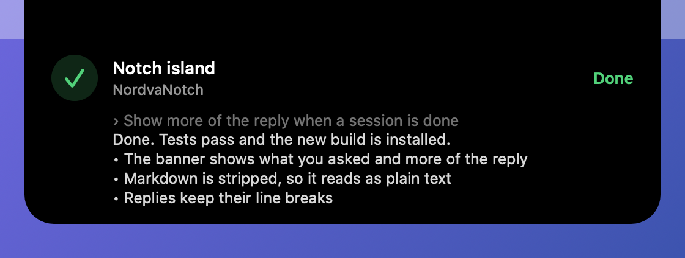
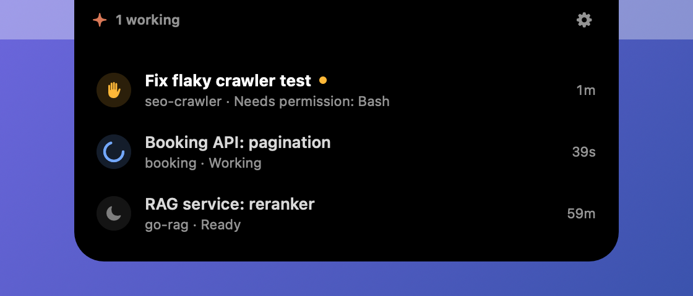

<p align="center"></p>

# NordvaNotch

A Dynamic Island for the MacBook notch that tells you when a Claude Code session needs you.

When you run two or three Claude Code sessions at once (in the terminal or in the Code tab of the Claude desktop app), they finish or stop for a question without a sound. NordvaNotch listens to Claude Code hooks and expands a black island out of the notch when a session finishes, fails or waits for you, with a light click on the trackpad. A click on the notch shows every session and its status.

<p align="center"></p>
<p align="center"></p>

## Features

- **Session events.** Finished, failed, asks a question, waits for plan approval, needs permission. The island expands for a few seconds with the session title, the project and the start of the last reply, then folds into a small dot with a count until you look.
- **Working sessions at a glance.** While any session works, a small spinner turns beside the notch with the number of working sessions. It is drawn by Core Animation, so it costs the app no redraws.
- **Reminders.** A session that still waits for you, or a result you have not opened, is announced once more after 10 minutes (5 to 30, or off).
- **Plan limits.** On a Pro or Max plan the list shows the five-hour and weekly limits, the numbers `/usage` shows, and warns at 80% of the five hours. Claude Code reports them only to a status line, which the terminal draws and the desktop app does not, so between reports the five hours are carried forward with the usage of every session since (shown with ≈).
- **Turn time and share.** Working sessions count their turn up; finished ones say how long it took. Each turn shows its estimated share of the five-hour limit, read from the transcript with its subagents, and a turn past 10% of it gets a warning. Without a plan (API billing) the same places show dollars at API prices.
- **Context fill.** Each session shows how full its context is, against `autoCompactWindow` from Claude Code's settings or the model's own window, and warns at 85% that compaction is near.
- **Haptic click.** One click when a session finishes, two when it needs you. The trackpad only plays it while a finger rests on it.
- **Peek.** Rest the pointer on the notch for a moment and a strip slides out with up to three sessions as pills, each with its status. Point at a pill to read its status or the start of the last reply, click it to jump to that session. A pointer that only passes the notch on its way to the menu bar does not open it.
- **Session list.** Click the notch: sessions that need you first, then new results, then running ones. Click a row to jump to that session: the Claude desktop app opens it directly, a terminal session brings its terminal app forward.
- **Real session names.** The title from the Claude desktop sidebar (or from `/rename` in the CLI), then the first prompt, then the folder. Claude worktrees show the repository name instead of the random worktree name.
- **Optional timer**, off by default (Settings → Timer). 5 to 45 minutes from the list or the menu bar; the countdown sits next to the notch, the end expands the island with a click and a sound.
- **Quiet during calls.** While a camera or a microphone is in use, nothing expands, clicks or plays a sound on its own. A dot waits instead.
- **Hidden from screen sharing.** Screenshots, recordings and shared screens leave the island out (on by default).
- **No notch, no problem.** With the lid closed or on an external display, the island hangs from the middle of the top edge. Events can also follow the display with the pointer.
- Menu bar item (optional, right-click the notch otherwise), launch at login.
- Scripts are ignored: `claude -p` and Agent SDK apps never expand the island.

## Requirements

- macOS 13 or later; made for a MacBook with a notch, works on any Mac.
- Claude Code with hooks (any recent version).

## Install

Works on macOS 13 or later, Apple Silicon or Intel.

### The quick way: one command

Open **Terminal** (press ⌘Space, type "Terminal"), paste this line and press Return:

```bash
curl -fsSL https://github.com/orhan17/NordvaNotch/releases/latest/download/NordvaNotch.zip -o /tmp/NordvaNotch.zip && { pkill -x NordvaNotch; sleep 1; rm -rf /Applications/NordvaNotch.app; ditto -x -k /tmp/NordvaNotch.zip /Applications && open /Applications/NordvaNotch.app; }
```

It downloads the latest release into Applications and opens it. Run the same line later to update.
A download made in Terminal is not marked as coming from the internet, so macOS does not stop the
app, or the hook helper inside it that Claude Code runs.

### Or download it

1. **Download** `NordvaNotch.dmg` from the [latest release](https://github.com/orhan17/NordvaNotch/releases/latest),
   open it and **drag NordvaNotch into Applications**.
2. The app is free and not notarized by Apple. Clear the download mark once, so macOS lets both the
   app and its hook helper run:

   ```bash
   xattr -dr com.apple.quarantine /Applications/NordvaNotch.app
   ```

3. **Open NordvaNotch.**

### Or build it

With the Xcode Command Line Tools:

```bash
git clone https://github.com/orhan17/NordvaNotch.git
cd NordvaNotch
./build.sh --install
```

## Connect Claude Code

NordvaNotch reads nothing from Claude Code by itself. Add its hook to `~/.claude/settings.json`: merge the block below into the `hooks` object, keeping any hooks you already have. **NordvaNotch Settings → Copy Hook Settings** copies the same block, and `/Applications/NordvaNotch.app/Contents/MacOS/NordvaNotch --print-hooks` prints it.

<details>
<summary>Hook settings</summary>

```json
{
  "hooks": {
    "SessionStart": [
      {
        "hooks": [
          {
            "type": "command",
            "command": "/Applications/NordvaNotch.app/Contents/MacOS/notch-hook || true",
            "async": true,
            "timeout": 5
          }
        ]
      }
    ],
    "UserPromptSubmit": [
      {
        "hooks": [
          {
            "type": "command",
            "command": "/Applications/NordvaNotch.app/Contents/MacOS/notch-hook || true",
            "async": true,
            "timeout": 5
          }
        ]
      }
    ],
    "PreToolUse": [
      {
        "matcher": "AskUserQuestion|ExitPlanMode",
        "hooks": [
          {
            "type": "command",
            "command": "/Applications/NordvaNotch.app/Contents/MacOS/notch-hook || true",
            "async": true,
            "timeout": 5
          }
        ]
      }
    ],
    "PermissionRequest": [
      {
        "hooks": [
          {
            "type": "command",
            "command": "/Applications/NordvaNotch.app/Contents/MacOS/notch-hook || true",
            "async": true,
            "timeout": 5
          }
        ]
      }
    ],
    "PostToolUse": [
      {
        "hooks": [
          {
            "type": "command",
            "command": "/Applications/NordvaNotch.app/Contents/MacOS/notch-hook || true",
            "async": true,
            "timeout": 5
          }
        ]
      }
    ],
    "PostToolUseFailure": [
      {
        "hooks": [
          {
            "type": "command",
            "command": "/Applications/NordvaNotch.app/Contents/MacOS/notch-hook || true",
            "async": true,
            "timeout": 5
          }
        ]
      }
    ],
    "Notification": [
      {
        "hooks": [
          {
            "type": "command",
            "command": "/Applications/NordvaNotch.app/Contents/MacOS/notch-hook || true",
            "async": true,
            "timeout": 5
          }
        ]
      }
    ],
    "Stop": [
      {
        "hooks": [
          {
            "type": "command",
            "command": "/Applications/NordvaNotch.app/Contents/MacOS/notch-hook || true",
            "async": true,
            "timeout": 5
          }
        ]
      }
    ],
    "StopFailure": [
      {
        "hooks": [
          {
            "type": "command",
            "command": "/Applications/NordvaNotch.app/Contents/MacOS/notch-hook || true",
            "async": true,
            "timeout": 5
          }
        ]
      }
    ],
    "SessionEnd": [
      {
        "hooks": [
          {
            "type": "command",
            "command": "/Applications/NordvaNotch.app/Contents/MacOS/notch-hook || true",
            "async": true,
            "timeout": 5
          }
        ]
      }
    ]
  }
}
```

</details>

Claude Code picks up the change in running sessions too. Every hook runs `notch-hook`, a small helper inside the app:

- `async: true`: Claude Code does not wait for it.
- `|| true`: the exit code is always 0, even if the app was removed, so a hook can never block or change what Claude does.
- It prints nothing, makes no network calls and finishes in a few tens of milliseconds.

| Event | What it means for the island |
| --- | --- |
| `UserPromptSubmit` | the session is working |
| `Stop` | the turn is over: finished |
| `StopFailure` | the turn ended on an API error |
| `PermissionRequest`, `Notification` | needs permission or input |
| `PreToolUse` (`AskUserQuestion`, `ExitPlanMode` only) | asks a question or waits for plan approval |
| `PostToolUse`, `PostToolUseFailure` | back to work after a permission prompt |
| `SessionStart`, `SessionEnd` | the session appears and goes away |

### Plan limits (Pro and Max)

To see the real five-hour and weekly limits, let NordvaNotch be Claude Code's status line. Add this to `~/.claude/settings.json` (keep your own `statusLine` if you have one; NordvaNotch then shows dollars instead):

```json
"statusLine": {
  "type": "command",
  "command": "/Applications/NordvaNotch.app/Contents/MacOS/notch-hook --statusline || true"
}
```

The terminal then shows `5h 58% · 7d 16% · ctx 5%` at the bottom, and NordvaNotch keeps the numbers in `~/Library/Application Support/NordvaNotch/limits.json`. The desktop app does not run status lines, so the numbers come from your terminal sessions; between them NordvaNotch carries the five hours forward from the usage of all sessions. A turn's share is an estimate: the window's real percentage spread over its requests by API price, since Anthropic does not publish how it weighs models, and chat in the Claude apps counts toward the same limit.

## Privacy

Everything stays on your Mac. The helper keeps one small JSON file per session in `~/Library/Application Support/NordvaNotch/sessions`: the session id, its folder, its title, the first 200 characters of your last prompt and the first 400 of Claude's last reply. Files of sessions untouched for three days are deleted.

To find the session title, the app reads the last few hundred kilobytes of the session transcript that Claude Code already keeps in `~/.claude/projects`.

Quiet during calls asks macOS whether a camera or microphone is running. It never opens one, so it needs no camera or microphone permission.

## How it works

- **Hook helper.** `notch-hook` parses the hook payload, applies it to the session's state under a file lock and writes the file atomically. Async hooks can finish out of order, so an event older than the stored state is dropped.
- **App.** Watches the sessions folder with a dispatch source and announces each new status once.
- **Notch.** `NSScreen.safeAreaInsets` and the auxiliary top areas give the notch size and position. The island is a borderless non-activating panel above the menu bar on every Space, including full-screen apps. It lets clicks through everywhere except the island itself.
- **Logic.** Session states, naming, ordering and geometry live in `NordvaNotchCore` and are covered by tests.

## Development

```bash
./test.sh                     # unit tests
./build.sh                    # build/NordvaNotch.app
./build.sh --install          # build, copy to /Applications, launch
./build.sh --release          # universal build/NordvaNotch.zip and .dmg
```

Handy flags of the app binary (`/Applications/NordvaNotch.app/Contents/MacOS/NordvaNotch`):

- `--check` prints displays, call state, hook status and the current sessions.
- `--print-hooks` prints the hook settings.
- `--demo banner|list|compact|timer|settings` shows made-up sessions.
- `--snapshot <dir>` renders the README pictures off screen.

## Uninstall

1. Remove the `notch-hook` entries from `~/.claude/settings.json`.
2. Quit NordvaNotch and delete `/Applications/NordvaNotch.app`.
3. Delete `~/Library/Application Support/NordvaNotch`.

## License

MIT
